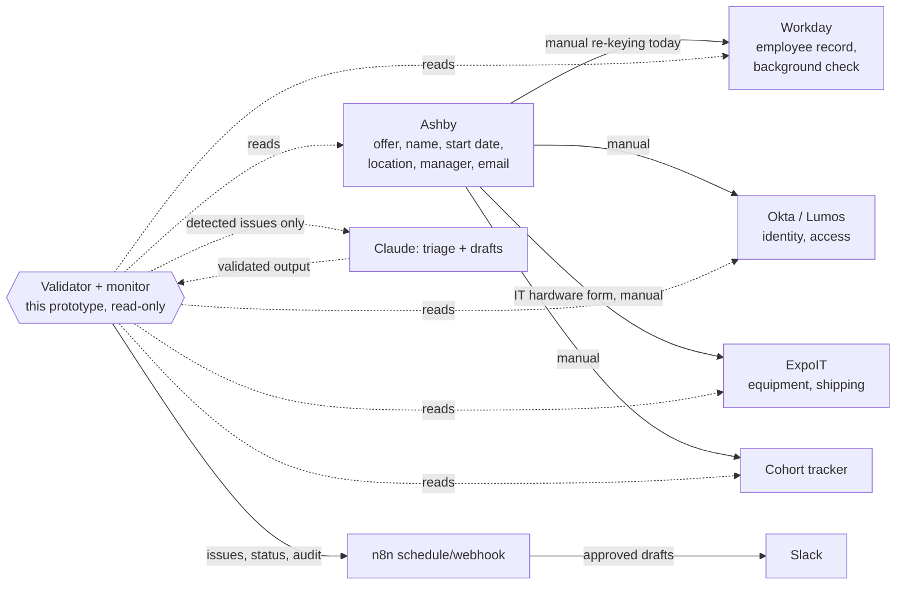

# Systems map

## Where the data lives and moves

| System | Role | Key fields used | Owner |
|---|---|---|---|
| Ashby | Source of truth for the hire | name, start date, work location, work email, manager | Recruiting |
| Workday | Employee record | same fields + background-check status | People Ops / HRIS |
| Okta / Lumos | Identity + access | name, email, account status | IT / Identity |
| ExpoIT | Equipment request | name, location, start date, ship-by, hardware-form submitted | IT / Procurement |
| Cohort tracker | Cohort roster | name, start date, location | Recruiting Coordination |

Assumptions (the brief does not specify): ExpoIT holds the hardware form, background-check status is
readable from Workday, and the cohort tracker is a Google Workspace sheet.

## Where it breaks today (from the brief)
1. **Changes don't propagate**: a post-offer change to start date, name or address is re-keyed by hand into
   four systems, or an off-cycle hire is created outside Ashby and never reaches the others.
2. **Bad data cascades**: a wrong name or location in Ashby flows into the Workday record, the Okta email,
   shipping labels and the tracker, with no cross-system check.
3. **Nobody watches the gates**: hardware form, background check and Okta provisioning are due about 7 days
   before start and are chased manually, if at all.

## The slice I built, and why
**Cross-system validation plus exception monitoring**: one read-only engine that (a) reconciles fields across
systems, (b) watches the 7-day gates, and (c) finds orphan records created outside Ashby.

Why this over the alternatives:
- **vs. change propagation**: propagation needs write access and a safe upsert per system. If the source is
  wrong, it spreads the error faster. Validation is the guardrail that makes propagation safe, is
  usable on day one with read-only access, and its issue list is exactly the input a propagation engine needs.
- **vs. exception monitoring alone**: a gate check is only meaningful if the underlying records are trusted.
  Monitoring is validation with a time dimension, so I built them together (`monitoring.py`).
- **Leverage**: failure mode 2 and 3 are caught directly, and failure mode 1 is caught after the fact
  (a missed propagation shows up as a mismatch or an orphan) without risking writes.

Deliberately not built: write-back / auto-fix, real API clients, a UI.

## Existing stack only
No new platform is added. The Python logic is the code layer for what low-code can't reach: normalization,
cross-record rules and failure handling. n8n schedules it (or calls the optional `src/api.py` wrapper
via an HTTP Request node), Slack receives alerts, Claude does the triage, and Claude Code / Cursor are the
build tools. If n8n cannot host Python, the same code runs as a scheduled script. Not added: a message queue,
a database, a separate monitoring product; the JSONL audit log is enough for this stage.
